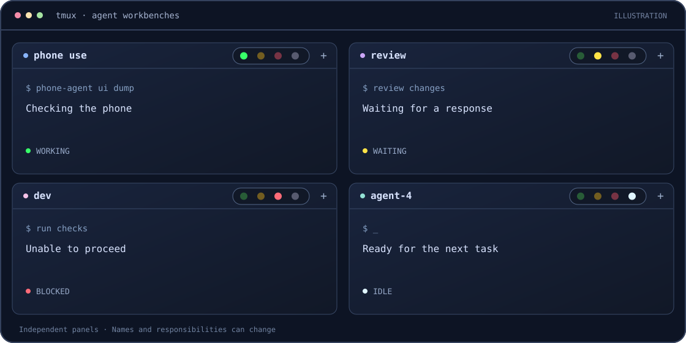

<div align="center">

# tmux-agent-adon

**为每一个 Agent 工位，点亮一盏信号灯。**

[English](README.md) · [简体中文](README.zh-CN.md) · [快速开始](#快速开始) · [agent-适配器](#agent-适配器)


</div>



## 为什么做它

我正在搭建一座软件工厂：手机和 Mac 上的 Agent 组成一支平等协作的 fleet。每个 tmux panel 都是一个通用工位，可以根据上下文改变名称和职责。我希望一眼看到哪些工位正在工作、等待、受阻或空闲。

**tmux-agent-adon 是这支 fleet 的信号灯，也可以作为任意 tmux panel 使用的通用组件。** 状态保存在 tmux 中，Agent 可以用普通命令报告状态；不需要中央控制器、数据库、消息队列或常驻守护进程。Agent 仍然自行决定如何工作和协作。

## 四盏灯

每个 panel 的右上角都有相同的四盏灯：

| 灯 | 工位状态 |
| :---: | --- |
| 🟢 | 正在工作 |
| 🟡 | 等待输入、其他 Agent 或外部条件 |
| 🔴 | 受阻或报告错误 |
| ⚪ | 空闲 |

接入 Agent 适配器或手动报告状态后，四盏灯显示各自的暗色，当前状态亮起。已接入但状态未知时，四灯保持暗色；没有状态报告方时，四灯显示中性暗灰。**灯表示工位报告的状态，不代表任务成功。**

工位名称可以随任务改变：一个 panel 现在可以叫 `phone use`，之后也可以叫 `dev`。快捷键未被占用时，两端均可用 `prefix + a` 打开当前 panel 的设置菜单；支持鼠标边框控件的 tmux 还可以点击 `+` 打开同一菜单。插件不会覆盖已有的其他绑定。

## 快速开始

需要 tmux、POSIX `sh` 和常用 Unix 工具，已测试 tmux 3.6a 和 3.8。建议使用支持 Unicode/Powerline 字形的终端；也提供 [ASCII 显示方案](examples/README.md)。

**1. 克隆并加载插件。** 在目标 tmux server 的终端中执行：

```sh
git clone https://github.com/toyauro/tmux-agent-adon.git ~/.local/share/tmux-agent-adon
export PATH="$HOME/.local/share/tmux-agent-adon/bin:$PATH"
tmux run-shell "$HOME/.local/share/tmux-agent-adon/agent-adon.tmux"
```

如需在以后打开的 shell 中使用 `lamp`，可把 `PATH` 设置写入 shell 配置。tmux server 重启后需要重新加载插件；仓库也包含 TPM 兼容入口。

**2. 显示灯组。** 在当前窗口试用内置边框标签：

```sh
tmux set-option -w pane-border-status top
tmux set-option -w pane-border-format '#{E:@agent_adon_label_format}'
```

这会修改**当前窗口**的边框格式。如果已有 tmux 主题，可以保留原样式，只把 `#[align=right]#{E:@agent_adon_indicator_format}` 合并进现有格式。主题集成、鼠标菜单和 ASCII 方案见 [显示集成指南](examples/README.md)。

**3. 设置当前工位的状态。**

```sh
lamp set working --name 'phone use' --detail '检查手机'
lamp set waiting --detail '等待 review'
lamp set error --detail '暂时无法继续'
lamp set idle
lamp disconnect                     # 回到无报告方的中性暗灰
```

`lamp` 默认操作当前 `$TMUX_PANE`；使用 `--pane %ID` 可指定同一 tmux server 的 panel。`lamp get --field state` 可读取当前状态。名称可以改变或重复，不是网络地址。`lamp set unknown` 只清除已知状态，不会断开已有报告方。

## Agent 适配器

适配器是可选的：它把 Agent 提供的事件转换成 panel 状态，不改变 Agent 的规划或工具使用方式。

| Agent | 接入方式 | 验证情况 |
| --- | --- | --- |
| **Pi** | `pi -e /path/to/tmux-agent-adon/adapters/pi` | 已在 Android 手机加载，并通过真实任务验证空闲 → 工作 → 空闲。 |
| **Claude Code** | [可选 hooks](adapters/hooks/README.md) | 隔离会话在运行中加载 hooks，真实报告工作 → 空闲。 |
| **Codex** | [Hooks 与热加载](adapters/codex/README.md) | 隔离 TUI 已验证 hooks 热加载；共享后台进程到 panel 的绑定仍为实验性功能。 |
| **Antigravity CLI** | [原生状态栏适配器](adapters/agy/README.md) | Mac 上已有 panel 无需重启，实际报告空闲 → 工作 → 空闲。 |
| **其他 Agent** | 在 shell 中调用 `lamp` | 无须专用适配器。 |

使用 Pi 前，请确保其 `PATH` 包含 `lamp`，或在启动前把 `LAMP_BIN` 设置为可执行文件的绝对路径。Hooks 适配器还需要 Python 3，并须按各 Agent 自身的规则配置和信任。

## 可选光晕

默认灯组使用普通终端文字。Ghostty 用户可以尝试实验性的[静态光晕 shader](effects/ghostty/README.md)，让灯更接近仪表台的视觉效果。它运行在观看画面的客户端，因此通过 SSH 查看远端手机时也可使用。同色的其他终端内容可能受到影响，需要在自己的终端和主题下验证。

## 使用边界

- 灯是状态报告，不是存活保证。进程被强制终止后可能留下旧状态；目前没有心跳或自动过期检测。
- tmux server 重启会清除 panel 的本地状态，报告方需要重新接入。
- 单次工具失败不一定代表 Agent 受阻；一次回复结束也不代表整个任务成功。
- 本项目只显示信号，不负责任务投递或 Agent 调度。

## 开发

```sh
python3 -m unittest discover -s tests -v
python3 -m unittest -v adapters.hooks.test_lamp_hook
node --test adapters/pi/*.test.js
```

测试使用隔离的 tmux server。欢迎贡献和扩展 Agent 适配器，项目使用 [MIT 许可证](LICENSE)。
